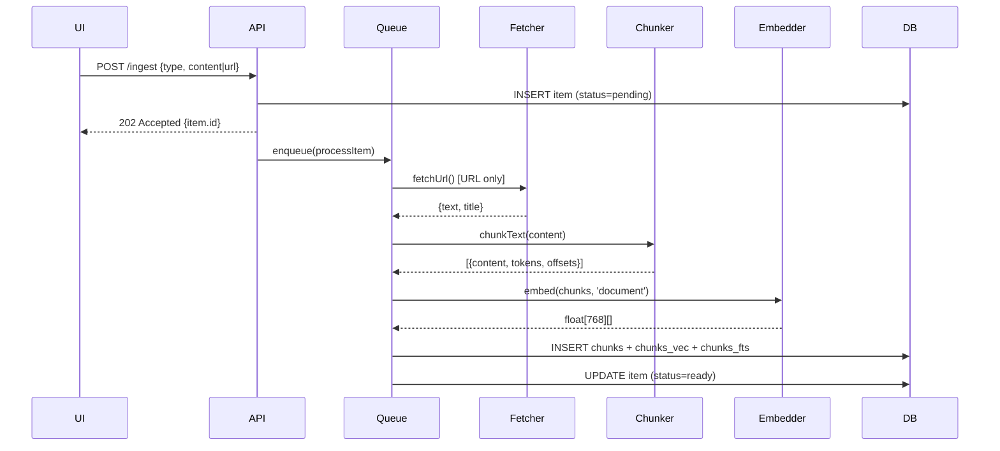
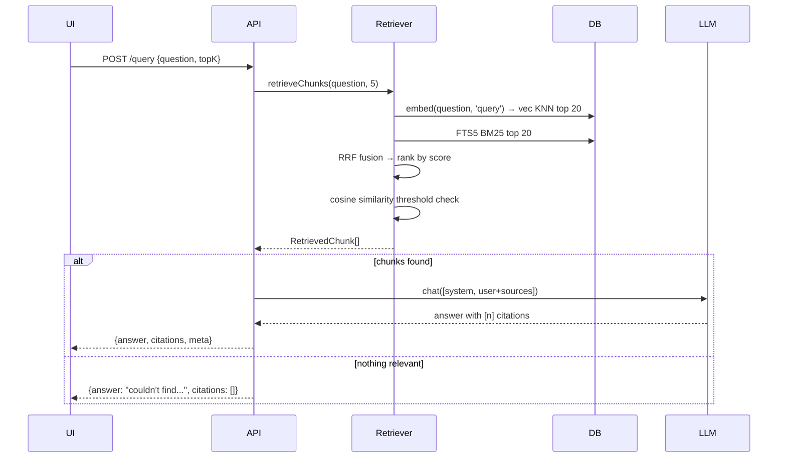

# Design Notes — AI Knowledge Inbox

## Architecture

### Ingest Flow

### Query Flow

---

## Chunking Approach

**Strategy:** paragraph-first, then sentence, then hard-split.

1. Normalize whitespace (collapse spaces, unify newlines)
2. Split on `\n\n` paragraph boundaries — this preserves semantic units
3. If a paragraph exceeds ~400 tokens, split further on sentence boundaries (`[.!?]\s+[A-Z]`)
4. If a single sentence exceeds the limit, hard-split by token count
5. Greedily pack units into ~400 token chunks with ~60 token overlap
6. Track `start_offset` / `end_offset` per chunk into the normalized text (for highlighting)

**Why 400 tokens / 60 overlap:**
- 400 tokens (~300 words) fits comfortably in the LLM context alongside other chunks
- 60 token overlap (~45 words) prevents answers that straddle chunk boundaries from being missed
- Paragraph/sentence boundaries keep semantically related sentences together, improving retrieval precision

**Alternatives considered:**
- *Fixed-size:* simple but splits mid-sentence, hurting embedding quality
- *Semantic chunking (embedding similarity between sentences):* higher quality boundaries but 10–50× slower at ingest time; overkill for this use case

**Token counting:** `js-tiktoken` with `cl100k_base` encoding — same tokenizer as GPT models, good approximation for other models too.

---

## AI Provider Choice

**Default: Ollama (local)**
- Zero cost — no API key, no per-token pricing
- Data never leaves the machine — suitable for private/confidential content
- Works offline
- Models: `nomic-embed-text` (768-dim embeddings), `llama3.2:3b` (chat)
- Tradeoff: slower on CPU (10–40s/query), lower quality than hosted models

**Optional: OpenAI**
- Higher quality embeddings (`text-embedding-3-small`, 1536-dim) and chat (`gpt-4o-mini`)
- Fast (~1–3s/query)
- Tradeoff: costs money, data leaves your machine, requires internet

**Pluggable interface:** both providers implement `AiProvider { embed(), chat() }`. Switching is a single env var change (`AI_PROVIDER=openai`). The rest of the codebase never knows which is active.

---

## Vector Store Choice

**Choice: SQLite + sqlite-vec + FTS5**

| Option | Pros | Cons |
|---|---|---|
| sqlite-vec (chosen) | Zero ops, single file, free, works offline | Brute-force KNN, single writer |
| pgvector | HNSW index, multi-writer, battle-tested | Requires PostgreSQL, more ops |
| Qdrant/Pinecone | Managed, scalable, fast ANN | External service, cost, network dependency |

**Why SQLite for this project:** the brief explicitly excludes external vector DBs. sqlite-vec enables vector search in the same SQLite file as the relational data — no extra process, no network, no config. FTS5 is built into SQLite and adds BM25 keyword search for free.

**Why hybrid retrieval (vec + FTS5):**
- Pure vector search misses exact keyword matches (e.g., searching "pgvector" may not match if the embedding is imprecise)
- Pure BM25 misses semantic matches (e.g., "automobile" ≠ "car" to keyword search)
- RRF fusion combines both: `score = Σ 1/(60 + rank)` — simple, parameter-free, empirically strong

---

## What Breaks at Scale

| Limit | Why | Mitigation |
|---|---|---|
| ~100k chunks | sqlite-vec uses brute-force KNN — O(n) scan per query | Switch to pgvector with HNSW index |
| Single writer | SQLite's WAL mode allows concurrent reads but only one writer | Postgres for multi-server |
| In-process queue | Jobs lost on crash (pending items re-enqueued on boot, but mid-flight work is lost) | BullMQ + Redis for durable jobs |
| CPU-bound LLM | llama3.2:3b on CPU: 10–40s/query | GPU, or use hosted API |
| No multi-tenancy | Single DB, no user isolation | Add user_id FK to items, row-level security |
| Large pages | Readability extracts full article text — very long pages produce many chunks | Per-item chunk cap, streaming ingestion |
| Model change | Switching embedding models requires re-embedding all items (dimension mismatch) | Store model name in meta table (done), add re-embed endpoint |

---

## Production Roadmap

1. **Storage:** Postgres + pgvector (HNSW index for sub-millisecond ANN at 1M+ vectors)
2. **Queue:** BullMQ + Redis (durable, retries, dead-letter queue, job visibility)
3. **Auth:** JWT or session-based, per-user item isolation
4. **Reranker:** Cross-encoder reranker after retrieval (e.g., `ms-marco-MiniLM`) for better precision
5. **Streaming:** Stream LLM tokens to frontend (SSE) for perceived faster responses
6. **Caching:** Cache query embeddings (same question asked twice) with a short TTL
7. **Observability:** OpenTelemetry tracing across ingest and query paths
8. **Eval in CI:** Run retrieval eval on every PR, fail if hit@5 drops below threshold
9. **Re-embed endpoint:** `POST /admin/reembed` to handle model migrations

---

## Eval Results

Run with `npx tsx scripts/eval.ts` after seeding with `npx tsx scripts/seed.ts`.

> Eval requires the backend server to be running with Ollama and seed data loaded.
> Results vary by hardware and model temperature.

| Metric | Result |
|---|---|
| hit@5 | run `npx tsx scripts/eval.ts` to generate |
| citation accuracy | run `npx tsx scripts/eval.ts` to generate |
| avg latency | run `npx tsx scripts/eval.ts` to generate |

**Methodology:** 10 question/answer pairs over 5 seed notes. `hit@5` = the expected source note appeared in the top-5 citations. Citation accuracy = the LLM included at least one `[n]` marker in its answer.
